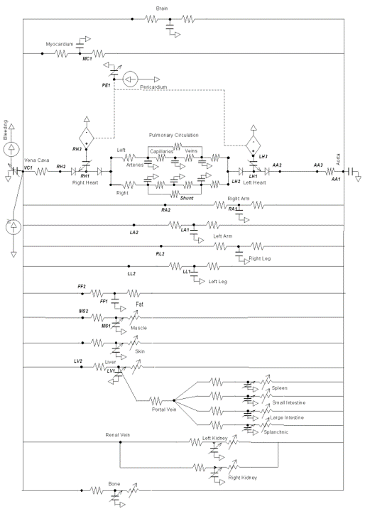

# viva-pulse

A [process-bigraph](https://github.com/vivarium-collective/process-bigraph) wrapper that drives the **real** [Kitware Pulse Physiology Engine](https://gitlab.kitware.com/physiology/engine) (whole-body adult model). Pulse runs as a time-stepped `Process`. Interventions are input ports, vital signs are output ports, and simulations are ordinary `process_bigraph.Composite` documents. Nothing is reimplemented or mocked: every number comes from Pulse's C++ engine through its own Python bindings.

## Status

- **Available:**
  - processes: `PulseProcess`, `PulseCircuitProcess`, `MapFluidController`;
  - composites: `pulse_hemorrhage`, `pulse_resuscitation`, and the per-circuit composites `pulse_cardiovascular`, `pulse_respiratory`, `pulse_mechanical_ventilation`.

  All are tested against the real engine.
- **Planned:** per-circuit composites for thermal, and ECMO and other equipment. See [docs/plan/plan-circuit-composites.md](docs/plan/plan-circuit-composites.md).

## Requirements

Pulse has no PyPI release, so it is built from source.

- A Pulse source checkout at `../engine`, pinned to engine commit `5e29e5b13` (Pulse 4.4.0).
- CMake ≥ 3.31, a C++20 compiler, and a JDK (Pulse's data generation uses Java).
- [uv](https://docs.astral.sh/uv/) and CPython 3.12. `PyPulse` must be compiled against the same Python that runs this package.

## Setup

```bash
uv venv --seed --python 3.12 .venv      # --seed: the Pulse build pip-installs protobuf into this venv

# Configure and build Pulse into .pulse-build/install (gitignored). Takes a while the first time.
VIRTUAL_ENV=$PWD/.venv cmake --fresh -S ../engine -B .pulse-build \
  -DCMAKE_BUILD_TYPE:STRING=Release -DPulse_PYTHON_HOME_DIR=$PWD/.venv \
  -DPython3_FIND_VIRTUALENV=ONLY \
  -DPulse_JAVA_API=ON -DPulse_PYTHON_API=ON -DPulse_GEN_DATA=ON
VIRTUAL_ENV=$PWD/.venv cmake --build .pulse-build -j 12

uv pip install -r ../engine/requirements.txt
uv pip install -e '.[dev]'
```

`-DPython3_EXECUTABLE` is ignored by Pulse's CMake; the venv is selected with `-DPulse_PYTHON_HOME_DIR` together with `VIRTUAL_ENV`. Build pins and known workarounds are in [.build-progress.md](.build-progress.md).

**Never run `uv sync`.** The venv is assembled by hand, and a sync would resolve protobuf away from the version Pulse generated its bindings with. It would also remove the dev and engine requirements. Run everything with `uv run --no-sync`.

### Finding the Pulse install

`viva_pulse.runtime` uses the first of these that is set:
1. the `install_dir` process config;
2. `$PULSE_INSTALL_DIR`;
3. `.pulse-build/install`.

An explicitly given location that is not a valid install raises `PulseNotFoundError`; it never falls back to another location.

## Usage

```python
from process_bigraph import Composite, gather_emitter_results

from viva_pulse.composites.hemorrhage import pulse_resuscitation
from viva_pulse.core import build_core

core = build_core()   # registers viva-pulse's processes explicitly
doc = pulse_resuscitation(core, compartment="RightLeg", severity=0.8, target_map_mmHg=90.0)
sim = Composite({"state": doc}, core=core)
sim.run(600)          # 600 simulated seconds -> 601 emitted rows (first at t=0)
rows = gather_emitter_results(sim)[("emitter",)]
```

### Composites

| Generator | What it runs |
|---|---|
| `pulse_hemorrhage` | Untreated hemorrhage at a chosen compartment and severity. Emits vital signs every second. |
| `pulse_resuscitation` | The same hemorrhage plus a closed-loop IV fluid controller that targets mean arterial pressure. |
| `pulse_cardiovascular` | The cardiovascular circuit, including its renal and tissue branches. Emits pressure, volume, inflow and outflow for 32 vascular regions, plus 20 hemodynamic values. Driven by Pulse's resistance and compliance multipliers and a hemorrhage. |
| `pulse_respiratory` | The respiratory (airway) circuit, either alone in Pulse's ventilation-mechanics engine (default) or coupled in the whole-body engine. Emits 24 breathing-mechanics values plus pressure, volume, inflow and outflow for 8 lung and pleural regions. Driven by Pulse's 10 respiratory resistance and compliance multipliers and intubation. |
| `pulse_mechanical_ventilation` | The same, with a pressure-control mechanical ventilator connected, plus the ventilator's 18 monitor values. Defaults follow Kitware's HowTo: intubated, AC mode, 19/5 cmH2O, 12 breaths/min. Settings, including `connected`, can change mid-run. |

All use `fidelity="real-bridge"`.

- **Whole-body runs** load Pulse's stabilized state files (`<install>/bin/states/*.json`, default `StandardMale@0s.json`).
- **Ventilation-mechanics runs** have no state files. They start from a patient file (`<install>/bin/patients/*.json`, default `StandardMale.json`), then settle before t=0 until every requested value is defined, which takes about one breath.
- Setting the file the chosen engine doesn't use (a `state_file` on ventilation-mechanics, a `patient_file` on whole-body) raises an error instead of being ignored.
- Setpoints apply from the first update. In `pulse_mechanical_ventilation`, the patient settles breathing spontaneously, so row 0 shows the ventilator monitor at 0 even though `interventions` say `connected=1`. The monitor values appear once the first ventilated breath completes, a few seconds in.
- In `AssistedControl` mode, a ventilator rate above the patient's own can lock Pulse into auto-triggering (about 50 breaths/min with high intrinsic PEEP). This is Pulse's own behavior and reproduces through its API alone. Use `ContinuousMandatoryVentilation` when the set rate must hold.

### Processes

- **`PulseProcess`**:
  - Loads a stabilized Pulse state and advances the engine by `interval` seconds per update.
  - Inputs `hemorrhage_severity` and `iv_rate_mL_per_min` are setpoints, sent to Pulse as actions only when they change.
  - Outputs are nine vital signs plus an `irreversible_state` flag. Vitals are `float` ports carrying deltas, seeded with the loaded readings, so each store always equals Pulse's own value. The reason for this design is in `.build-progress.md`.
- **`PulseCircuitProcess`**: one real Pulse engine exposing the circuit modules named in `config.modules` (see `viva_pulse/circuits/`).
  - Each module's readings are a nested subtree of `float` delta ports. For example, `cardiovascular/central/aorta/pressure_mmHg` is wired to `circuits/cardiovascular/...`.
  - Its setpoints sit under the `setpoints` input port and are wired to `interventions/<module>/...`. Each defaults to its baseline (multipliers 1.0, hemorrhage 0.0) and is sent to Pulse only when it changes.
  - Identical requests from several modules share one Pulse request. A request Pulse cannot serve fails the load, or the update where it appears, instead of emitting NaN.
  - `model_type` selects the engine: `whole_body`, or `ventilation_mechanics`, which has the airway only (no blood or chemoreflex). Each module declares which engines it supports.
- **`MapFluidController`**: a proportional `Step` that maps mean arterial pressure to IV infusion rate.

## Pulse circuits

Pulse models physiology as lumped-parameter circuits. `pulse_cardiovascular` exposes the cardiovascular circuit below. Its `central`, `renal` and `peripheral` sub-stores follow the diagram's branches.

```python
from process_bigraph import Composite, gather_emitter_results

from viva_pulse.composites import pulse_cardiovascular
from viva_pulse.core import build_core

core = build_core()
sim = Composite({"state": pulse_cardiovascular(core, systemic_resistance_multiplier=2.0)}, core=core)
sim.run(60)
cv = gather_emitter_results(sim)[("emitter",)][-1]["circuits"]["cardiovascular"]
cv["central"]["aorta"]["pressure_mmHg"]
cv["hemodynamics"]["heart_rate_bpm"]   # about 43 bpm: the baroreflex answers doubled systemic resistance
```

Region readings are instantaneous within each heartbeat. Use `interval=0.02` (Pulse's timestep) to resolve waveforms; the default 1 s sampling aliases the cardiac cycle. Because process-bigraph accumulates time as floats, an interval that isn't exact in binary, such as 0.02, can lose the last update of a run: `run(2.0)` at 0.02 s emits rows up to t=1.98. Python can only reach regions (Pulse compartments), not individual circuit nodes or paths, because Pulse's bindings expose no node-level data requests.



*Pulse cardiovascular circuit diagram. Copyright Kitware, Inc. and Contributors, Apache License 2.0, from `engine/docs/Images/Cardiovascular/CardiovascularCircuit.png`.*

### Respiratory circuit, alone or coupled

`pulse_respiratory` runs the same module on either engine. That shows how much of a response comes from the airway circuit itself and how much from the rest of the body:

```python
from process_bigraph import Composite, gather_emitter_results

from viva_pulse.composites import pulse_respiratory
from viva_pulse.core import build_core

for engine in ("ventilation_mechanics", "whole_body"):
    core = build_core()
    doc = pulse_respiratory(core, model_type=engine,
                            left_compliance_multiplier=0.5, right_compliance_multiplier=0.5)
    sim = Composite({"state": doc}, core=core)
    sim.run(60)
    mechanics = gather_emitter_results(sim)[("emitter",)][-1]["circuits"]["respiratory"]["mechanics"]
    print(engine, round(mechanics["tidal_volume_mL"]), round(mechanics["respiration_rate_bpm"], 1))
# ventilation_mechanics 270 12.0   <- stiffer lungs, no compensation
# whole_body 388 15.0              <- the chemoreflex raises the breathing rate
```

Lung and pleural region pressures (`absolute_pressure_cmH2O`) are absolute, with Pulse's ambient at 1033.2 cmH2O. The `mechanics` pressures are relative to atmosphere. Intubation is one-way, because Pulse's Python API drops extubation actions; setting `intubated` from 1 back to 0 raises an error rather than leaving the store and the engine out of sync.

## Tests

```bash
uv run --no-sync pytest -q
```

The full suite takes about 100 s. Every engine-dependent test drives the real Pulse build; nothing is mocked. Where a test needs an expected value, it loads its own engine directly through Pulse's Python API.

## Regarding using the Python binding

The existing Pulse python binding (`src/python/*`) is a light wrapper, not a 1:1 binding. There are two layers:
  
1. The compiled part (PyPulse, built with pybind11) is thin. It exposes one engine handle with about 15 methods (src/python/pybind/PulseEngines.cpp:18-44):
   load or save state, initialize, process actions, advance time, pull data, and logs/events. Everything crossing that boundary is a JSON or protobuf string,
   or a flat array of numbers. None of the C++ internals are reachable as objects: no circuits, nodes, paths, compartments, models or solver.
2. The pulse Python package is a pure-Python copy of Pulse's data model, not of the engine. It has classes for actions, patients, configurations, data requests
   and scalars with units. Your Python objects get serialized to the same protobuf format and handed to the C++ engine. That copy is broad but incomplete.
   Anesthesia-machine and inhaler actions are missing, for example, as is the circuit-override action.

So Python can do what a scenario file can: load a patient, apply actions, step time, and read named values (whole-body vitals, region pressures, volumes, flows
and substances). It can't reach inside the engine, which is why the circuit composites work at the region level, not node by node. Making it closer to 1:1
would mean writing new pybind bindings in ../engine. That's the "bind more of the C++" option we set aside.

---

## License

viva-pulse is MIT-licensed. Pulse is distributed by Kitware, Inc. under the Apache License 2.0; see `../engine/LICENSE` and `../engine/NOTICE`.

